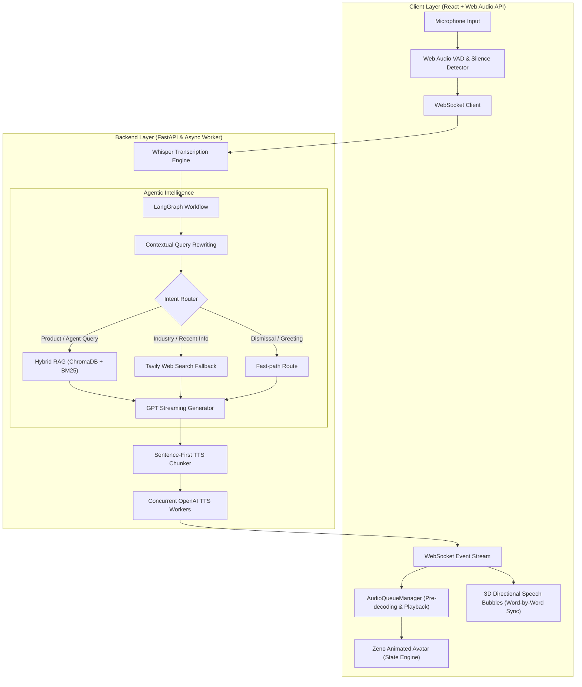

# Zeno AI Voice Assistant — Meeting Notes & Technical Overview

> [!NOTE]
> **Purpose**: Use these notes as an executive briefing and technical presentation guide for explaining how Zeno works, its end-to-end architecture, and its real-time conversational capabilities at events.

---

## 1. Executive Summary (The 30-Second Elevator Pitch)

**Zeno** is Netcore’s event-facing AI brand ambassador—an autonomous, real-time voice assistant combining:
1. **Interactive Animated Avatar**: Dynamic video-state transitions (Idle, Greeting, Thinking, Talking, Listening, Goodbye) with floating 3D directional speech bubbles.
2. **Sub-Second Voice Turnaround**: Simultaneous streaming transcription, LLM reasoning, concurrent TTS synthesis, and Web Audio streaming playback.
3. **Enterprise-Grounded RAG**: LangGraph-orchestrated retrieval engine grounded in Netcore’s verified knowledge base (autonomous AI agents, MarTech platform capabilities, and live web search fallback).

---

## 2. System Architecture at a Glance

---

## 3. End-to-End Conversational Flow (Step-by-Step)

### Phase 1: Voice Input & Turn-Taking
1. **Adaptive Voice Activity Detection (VAD)**:
   * Uses the Web Audio API Analyser node directly in the browser to compute RMS energy and speech bands in real-time.
   * Tolerates natural pauses (2.4s baseline, 3.2s for trailing conjunctions like *"and"*, *"what about"*) so visitors asking multi-part questions are not cut off.
2. **Live WebSocket Transcription**:
   * Audio streams over a dedicated WebSocket (`/ws/transcribe`) using OpenAI Whisper to produce instant live transcripts.

### Phase 2: Agentic Reasoning & RAG Retrieval
1. **Contextual Query Rewriting**:
   * Evaluates the last 20 messages of conversational history to resolve pronouns and references (e.g., *"How do they work together?"* $\rightarrow$ *"How do Netcore's autonomous AI marketing agents collaborate?"*).
2. **Intent Routing**:
   * **Greetings & Dismissals**: Handled through zero-latency fast-paths with client/server pre-cached audio.
   * **Product & AI Agent Questions**: Routed to **Hybrid RAG** (combining ChromaDB dense embeddings with BM25 keyword matching) over verified Netcore documents.
   * **External/Industry Trends**: Routed to live web search verification via Tavily.

### Phase 3: Concurrent TTS & Audio Streaming Pipeline
1. **Sentence-First Chunking**:
   * The custom `TTSChunker` buffers LLM delta tokens and triggers synthesis on **complete sentences** (`.`, `!`, `?`), ensuring speech bubbles contain complete, natural thoughts.
2. **Asynchronous Synthesis Pool**:
   * Multiple sentence chunks are submitted to an async TTS worker queue concurrently. Chunk 0 is sent immediately to the browser without waiting for the full LLM response to complete.
3. **Monotonic Sequence Delivery**:
   * Chunks are guaranteed to arrive and play in strict sequence ($0, 1, 2, \dots$) with zero audio stutter or syllable clipping.

### Phase 4: Avatar Animation & 3D Visual Sync
1. **Synchronized Speech Bubbles**:
   * Each sentence occupies a dedicated 3D callout bubble placed around Zeno (Slot 0: Top-Left, Slot 1: Top-Right, Slot 2: Bottom-Left, Slot 3: Bottom-Right).
   * Directional SVG pointer tails face Zeno's head and torso.
   * Text renders word-by-word paced to the exact duration of the playing audio chunk.
2. **Seamless Video Engine**:
   * Zero-flicker state machine driving high-definition MP4 character loops (`idle`, `greeting`, `thinking`, `talking`, `listening`, `goodbye`).
   * When audio finishes, Zeno automatically transitions to **Listening** mode and reactivates the microphone for the visitor's next question.

---

## 4. Key Engineering Highlights to Mention in the Meeting

| Feature | How It Works | Business / User Benefit |
| :--- | :--- | :--- |
| **Sub-Second First Audio** | Starts TTS on Sentence 0 while Sentence 1 & 2 are still being generated. | Eliminates the awkward 3–5 second silence typical of voice bots. |
| **AudioQueueManager** | Pre-decodes base64 audio into Web Audio `AudioBuffer` objects before playback time. | Zero pause between spoken sentences; eliminates clipping on the first words. |
| **No External Avatar SDK** | Pure client-side MP4 video blending and CSS 3D perspectives without third-party avatar streaming APIs (like D-ID or HeyGen). | **100% reliable**, zero recurring streaming cost, works offline/on local kiosks, zero buffering. |
| **Enterprise RAG Grounding** | LangGraph pipeline strictly constrained by verified Netcore knowledge assets. | Eliminates hallucination; accurately distinguishes between publicly confirmed features and announcements. |
| **Responsive Portrait/Landscape** | Adaptive layout engine with specialized totem/portrait support (`630×845` responsive kiosk mode). | Perfect for touchscreen event booths, totems, tablets, and desktop displays. |

---

## 5. Potential Meeting Questions & Answers

### Q: "How does Zeno avoid interrupting users when they pause?"
> **Answer**: Zeno uses an **adaptive silence window** in its Web Audio VAD. Rather than a rigid timer, it grants 2.4 seconds of pause time, and automatically extends to 3.2 seconds if the visitor ends on a connecting thought (like *"and"*, *"also"*, *"because"*).

### Q: "What prevents the speech bubbles from covering the avatar?"
> **Answer**: The avatar is centered with bounded maximum dimensions (`clamp(320px, 58vh, 580px)` in landscape and `min(70vw, 52vh)` in portrait). The 4 callout slots use percentage-based offsets and 3D transforms (`rotateY`, `translateZ`) positioned in the perimeter margins around Zeno, with directional tails pointing inward.

### Q: "How accurate is Zeno's knowledge about Netcore?"
> **Answer**: The assistant runs on a **Hybrid RAG engine** (dense vector search + BM25 keyword matching) grounded in approved documentation covering Netcore's platform, the 6 core AI agents (Audience, Content, Scheduler, Insights, Decisioning, Shopping), AMP email, and enterprise support. If information is outside approved scope, it transparently qualifies the source or falls back to live web search.

---

## 6. Recommended Meeting Agenda / Demo Script

1. **Live Greeting Demo (1 min)**:
   * Show the Start Screen with Zeno in Idle state.
   * Click *"Start Conversation"*; point out the instantaneous preloaded greeting playback and wave animation.
2. **Substantive Question Demo (2 mins)**:
   * Ask: *"How do Netcore's AI marketing agents collaborate with each other?"*
   * Highlight:
     * Fast transition from Thinking to Talking.
     * Audio starting immediately on the first sentence.
     * The 3D speech bubbles populating one complete sentence per box around Zeno.
     * The automatic transition back to Listening with microphone auto-activation.
3. **Architecture Walkthrough (2 mins)**:
   * Refer to the 3-tier pipeline: **Web Audio Client $\rightarrow$ LangGraph RAG $\rightarrow$ Concurrent TTS Streaming**.
4. **Q&A & Enterprise Readiness (2 mins)**:
   * Highlight zero third-party streaming fees, high reliability, and kiosk/totem compatibility.

