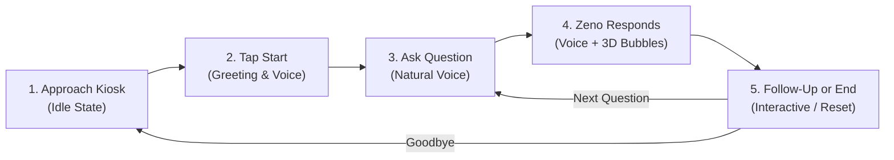
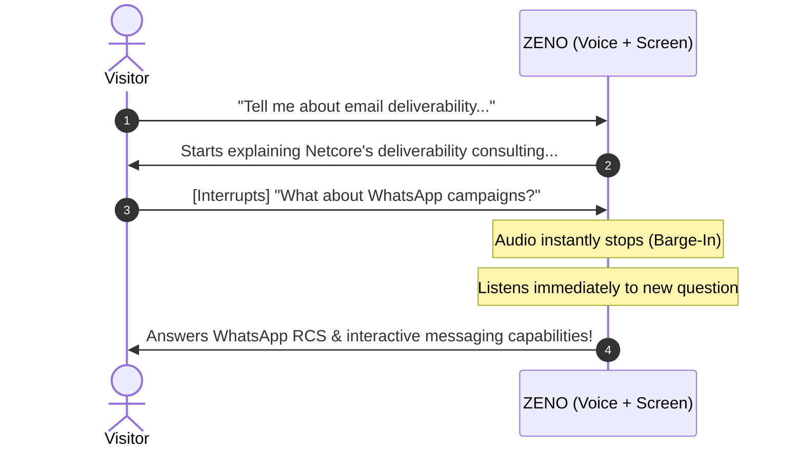

# ZENO: The Voice-First Event Experience
## Presentation: How the Zeno Voice Assistant Works (User Flow)

---

### Slide 1: Title & Purpose

# Meet ZENO
### Netcore’s Interactive AI Brand Ambassador

> **"A seamless, hands-free voice experience designed for live event booths, kiosks, and interactive totems."**

* **Presenter:** Event & Product Team
* **Audience:** Leadership, Marketing, & Event Stakeholders
* **Focus:** End-to-end visitor experience, interaction flow, and visual interface (zero code / no complex technical jargon).

---

### Slide 2: The Vision & Core Concept

## Why an AI Brand Ambassador?

At live marketing events and exhibitions, attendees want quick, engaging answers without waiting in line for a booth representative.

```
       Traditional Kiosks                     Zeno AI Ambassador
┌─────────────────────────────────┐   ┌─────────────────────────────────┐
│ • Static touch menus            │   │ • Living, animated 3D character │
│ • Endless browsing & reading    │   │ • Natural voice conversation    │
│ • Impersonal tablet forms       │   │ • Instant personalized answers  │
│ • Bottleneck at busy booths     │   │ • Engaging 3D speech visuals    │
└─────────────────────────────────┘   └─────────────────────────────────┘
```

### Core Design Philosophy:
1. **Zero Learning Curve:** If you can talk, you can use Zeno.
2. **Instant Warmth:** Friendly animated expressions and proactive professional greeting.
3. **Always Available:** Continuously ready to engage booth visitors 24/7.

---

### Slide 3: Complete User Journey at a Glance

## The 5-Step Visitor Flow



| Step | What the Visitor Does | What Zeno Does |
| :--- | :--- | :--- |
| **1. Approach** | Walks up to the totem / kiosk screen | Zeno breathes, idles, and visually invites the visitor |
| **2. Welcome** | Taps *"Start Conversation"* | Waves, introduces himself, and opens the microphone |
| **3. Speak** | Asks any question in plain English | Shows live audio wave & converts speech into text |
| **4. Listen** | Hears Zeno speak the answer | Speaks clearly while floating 3D bubbles appear around him |
| **5. Wrap-Up** | Says goodbye or taps *"End Conversation"* | Delivers a warm farewell and resets for the next guest |

---

### Slide 4: Step 1 — The Approach (Standby / Idle State)

## Clean, Uncluttered Kiosk Presence

```
┌────────────────────────────────────────────────────────┐
│  🟢 Connected                 ZENO                     │
│                   Netcore AI Brand Ambassador          │
│                                                        │
│                                                        │
│                    ╭───────────╮                       │
│                    │  ( ^ _ ^) │                       │
│                    │   ZENO    │                       │
│                    ╰───┬───┬───╯   [ Start             │
│                        │   │         Conversation 🪄 ] │
│                        ╵   ╵                           │
│                                                        │
│                                                        │
└────────────────────────────────────────────────────────┘
```

### Visitor Experience:
* **Prominent Character Presence:** Zeno stands tall on the screen with gentle breathing and blinking animations.
* **Branded Header:** Top title clearly states *"ZENO — Netcore AI Brand Ambassador"*.
* **Green Readiness Dot:** Subtle indicator showing the system is live and connected.
* **Hand-Anchored Call to Action:** The *"Start Conversation"* button sits right beside Zeno's hand, inviting visitors to tap and talk.

---

### Slide 5: Step 2 — The Welcome & Greeting

## First Impressions: Setting a Professional Tone

When the visitor taps **"Start Conversation"**:

1. **Instant Animated Greeting:**
   * Zeno transitions into a friendly welcoming gesture.
2. **Warm Professional Voice:**
   * Zeno speaks: *"Welcome to Netcore. I am Zeno, your AI Brand Ambassador. How may I assist you today?"*
3. **Automatic Hands-Free Listening:**
   * The microphone activates automatically as soon as the greeting finishes.
   * A glowing status pill indicates: **"🟢 I'm listening... Ask a question or tap mic"**.

> [!NOTE]
> The visitor never has to configure settings, select language menus, or type text. Interaction starts with a natural spoken welcome.

---

### Slide 6: Step 3 — Asking Questions (Hands-Free Speech)

## Natural Voice Interaction — No Scripts Needed

```
Visitor speaks:
"What kind of AI agents does Netcore offer for marketers?"
       │
       ▼
┌────────────────────────────────────────────────────────┐
│                                                        │
│                   ╭───────────╮                        │
│                   │  ( 👂 _ 👂)│                        │
│                   ╰───┬───┬───╯                        │
│                       │   │                            │
│                                                        │
│             🟢 I'm listening...                        │
│         [ ılılılllılı  "What kind of AI agents..." ]   │
│                                                        │
└────────────────────────────────────────────────────────┘
```

### Key Experience Highlights:
* **Natural Language Flexibility:** Visitors can speak casually, ask complex questions, or inquire about specific marketing pain points.
* **Smart Silence Detection (VAD):** The system knows when the user begins speaking and automatically detects when they finish pausing. No need to hold down a button.
* **Live Transcription Feedback:** A real-time caption dock shows the spoken words with an animated waveform so the visitor knows they were understood.

---

### Slide 7: Step 4 — Zeno Responds (Voice + 3D Bubbles)

## Multi-Sensory Engagement: Hear It & See It

When Zeno answers, he doesn't just read dry text—he delivers a synchronized voice and visual experience:

```
┌────────────────────────────────────────────────────────┐
│                                                        │
│   ┌────────────────────┐          ┌──────────────────┐ │
│   │ 💬 Audience Agent: │          │ 💬 Content Agent │ │
│   │ builds goal-driven │   (^_^)  │ creates brand-   │ │
│   │ customer segments. │  / ZENO \│ aligned copy.    │ │
│   └────────────────────┘  ╰─┬──┬─╯└──────────────────┘ │
│                             │  │                       │
│   ┌────────────────────┐          ┌──────────────────┐ │
│   │ 💬 Scheduler Agent │          │ 💬 Insights,     │ │
│   │ optimizes delivery.│          │ Decisioning...   │ │
│   └────────────────────┘          └──────────────────┘ │
│                                                        │
│                   🔵 Speaking...                       │
│                                                        │
└────────────────────────────────────────────────────────┘
```

### What Makes This Unique?
1. **3D Floating Speech Bubbles:**
   * Key sentences float cleanly **around** Zeno in 3D perspective callouts—never obscuring his face or chest.
   * Highlighted in real time to match the spoken audio.
2. **Substantive Answers First:**
   * Zeno directly answers the question within 2 to 3 clear, crisp sentences.
3. **Official 6-Agent Knowledge:**
   * Expertly details Netcore's **six specialized AI agents**:
     1. **Audience Agent** (cohort discovery)
     2. **Content Agent** (creative generation)
     3. **Scheduler Agent** (delivery timing & fatigue prevention)
     4. **Insights Agent** (journey diagnostics)
     5. **Decisioning Agent** (next-best-action selection)
     6. **Shopping Agent** (conversational commerce)
4. **Contextual Engagement:**
   * Concludes with an engaging question specific to the discussed topic (e.g., *"Would you like to explore how the Audience Agent builds predictive micro-segments?"*).

---

### Slide 8: Step 5 — Fluid Conversation & Barge-In

## Two-Way Dialogue with Interruptibility

Event conversations aren't one-sided lectures. Visitors often want to interrupt, clarify, or change topics mid-sentence.



### Experience Features:
* **Barge-in / Speech Interruption:** Tapping the mic or speaking mid-response immediately stops audio playback and seamlessly routes to the new question.
* **Conversational Memory:** Remembers the context of previous questions in the same session.
* **Optional Text & Transcript Drawer:** Visitors or booth staff can tap *"Show Chat"* to see the full transcript history or type questions in high-noise expo environments.

---

### Slide 9: Step 6 — Graceful Wrap-Up & Instant Reset

## Ready for the Next Booth Attendee

When the visitor is done (by saying *"Thank you, goodbye"* or clicking *"End Conversation"*):

```
┌────────────────────────────────────────────────────────┐
│                                                        │
│                     ╭───────────╮                      │
│                     │  ( ^ o ^) 👋  "Thank you for    │
│                     │   ZENO    │    visiting Netcore! │
│                     ╰───┬───┬───╯    Have a great day!"│
│                         │   │                          │
│                                                        │
│                    👋 Goodbye!                         │
│                                                        │
│         [ Smoothly resets back to Start Screen ]       │
└────────────────────────────────────────────────────────┘
```

1. **Warm Farewell:** Zeno performs a polite waving gesture and speaks a brief thank-you message.
2. **Automatic Session Cleanup:** Clears active audio buffers and speech bubbles.
3. **Instant Kiosk Reset:** Returns automatically to the fresh Start Screen, welcoming the next booth attendee with zero manual reboot required.

---

### Slide 10: Summary & Event Takeaways

## Why Zeno Elevates the Booth Experience

```
┌────────────────────────────────────────────────────────────────────────┐
│                        ZENO VALUE PROPOSITION                         │
├────────────────────────────────────────────────────────────────────────┤
│  ⚡ Frictionless    │ Walk up, tap once, talk naturally.              │
│  🎨 Eye-Catching    │ 3D floating bubbles + animated branded mascot.   │
│  🎯 Brand Accurate  │ Grounded in approved Netcore capabilities.       │
│  🔄 Low Maintenance │ Self-resetting kiosk flow, ready for thousands.  │
└────────────────────────────────────────────────────────────────────────┘
```

### Quick Presentation Checklist for Your Meeting:
* [x] **Walk-up Simplicity:** Highlight how attendees don't need any instructions to get started.
* [x] **Voice-First Design:** Demonstrate hands-free speaking and instant audio playback.
* [x] **Visual Polish:** Showcase how 3D floating callouts keep attendees engaged even from a distance.
* [x] **Smart Boundaries:** Emphasize that Zeno stays strictly on-topic with Netcore's verified 6-agent product suite.

---

### Questions & Discussion
*Open for questions on booth deployment, hardware setup, and visitor interaction metrics.*

